# EVAura — Mental Health Risk Prediction: Project Results & Architecture Summary

## Executive Summary

The **EVAura** project delivers an end-to-end Machine Learning pipeline designed to assess and predict student mental health risk levels (**Low**, **Medium**, **High**) based on academic workload, physiological habits, digital lifestyle, and financial/social support factors.

Through rigorous 5-fold Stratified Cross-Validation across 5 model families and systematic hyperparameter tuning, **Tuned Logistic Regression ($C=0.5$, $\ell_2$ penalty, `lbfgs` solver)** was selected as the optimal production model, achieving:
- **Test Accuracy:** **$75.80\%$**
- **Test Macro F1-Score:** **$0.7571$**
- **Test Macro ROC-AUC:** **$0.9109$**
- **Critical High-Risk Recall:** **$81.18\%$** with **$0$ Low-Risk false negatives**

---

## 1. Optimal Preprocessing Pipeline & Design Decisions

### 1.1 Overview of the Pipeline Flow
The winning preprocessing architecture guarantees zero data leakage by computing all parameters strictly on the training set:

```mermaid
flowchart LR
    A["Raw Data (smh_raw.csv)"] --> B["Data Cleaning & Integrity"]
    B --> C["Stratified Split (80/20)"]
    C --> D["Median & Mode Imputation"]
    D --> E["1.5 × IQR Capping (Winsorization)"]
    E --> F["Domain Feature Engineering"]
    F --> G["3-Step Feature Selection"]
    G --> H["Categorical Encoding"]
    H --> I["StandardScaler Normalization"]
    I --> J["Tuned Classifier (C=0.5)"]
```



---

### 1.2 Data Cleaning & Anomaly Correction
1. **Identifier Removal:** `Student_ID` is an arbitrary sequence with zero predictive generalization; removed upfront.
2. **Domain Inconsistency Rectification:**
   - Samples where `Social_Media_Hours > Screen_Time_Hours` (logically impossible) were transformed to `np.nan` and imputed using median statistics.
   - Text fields were standardized (stripped whitespace and capitalized).

---

### 1.3 Outlier Handling: 1.5 × IQR Capping (Winsorization)
- **Problem with $4 \times \text{IQR}$:** An arbitrary $4 \times \text{IQR}$ multiplier resulted in overly wide thresholds (e.g., lower bound of $0.0$ for `Sleep_Hours`, $0.45$ for `GPA`), detecting $0$ outliers.
- **Tukey $1.5 \times \text{IQR}$ Rule:** Adopted on all continuous features (`Age`, `Sleep_Hours`, `Study_Hours_Per_Week`, `GPA`, `Social_Media_Hours`, `Screen_Time_Hours`, `Attendance_Rate`), correctly detecting 56 extreme points across 51 rows ($3.4\%$ of training data).
- **Why Capping Over Deletion?**
  - **Deletion:** Dropping rows removes valuable training samples and cannot be applied in production inference or test set evaluation where every incoming user must receive a prediction.
  - **Capping (Winsorization):** Clamping values to $[\text{Lower Bound}, \text{Upper Bound}]$ prevents extreme gradient distortions and numerical instability in linear and distance models while preserving $100\%$ of data points.
  - **Leakage Prevention:** Bounds were computed **strictly on `x_train`** and applied to both `x_train` and `x_test`.

---

### 1.4 Feature Engineering & Simplified Selection

#### A. Domain Candidate Features Created:
1. `Stress_to_Support_Ratio` = $\frac{\text{Financial\_Stress}}{\text{Family\_Support} + 10^{-5}}$ (measures external pressure relative to the emotional safety net).
2. `Academic_Effort_Index` = $\text{GPA} \times \left(\frac{\text{Study\_Hours\_Per\_Week}}{10}\right)$ (measures academic productivity and investment).
3. `Non_Social_Screen_Time` = $\max(0, \text{Screen\_Time\_Hours} - \text{Social\_Media\_Hours})$ (productive screen time).
4. `Sleep_Deficit` = $\max(0, 7.5 - \text{Sleep\_Hours})$ (deficiency below healthy sleep threshold).
5. `Study_to_Sleep_Ratio` = $\frac{\text{Study\_Hours\_Per\_Week}}{\text{Sleep\_Hours} \times 7 + 10^{-5}}$ (study burden relative to rest).
6. `Social_Media_Share` = $\frac{\text{Social\_Media\_Hours}}{\text{Screen\_Time\_Hours} + 10^{-5}}$ (percentage of screen time spent on social apps).

#### B. 3-Step Selection Strategy:
- **Filter 1 (Low Variance):** Dropped features with $\sigma^2 < 0.02$. `Social_Media_Share` ($\sigma^2 = 0.0147$) was dropped due to near-zero spread.
- **Filter 2 (Multicollinearity / Redundancy):** For feature pairs with $|r| \ge 0.75$, the feature with higher correlation to target risk was kept:
  - `(Sleep_Hours, Sleep_Deficit)` ($r = 0.949$) $\rightarrow$ Dropped `Sleep_Deficit` (kept `Sleep_Hours`, target $r = 0.538$).
  - `(Study_Hours_Per_Week, Study_to_Sleep_Ratio)` ($r = 0.842$) $\rightarrow$ Dropped `Study_to_Sleep_Ratio` (target $r = 0.056$).
  - `(Study_Hours_Per_Week, Academic_Effort_Index)` ($r = 0.944$) $\rightarrow$ Dropped `Study_Hours_Per_Week` (kept new feature `Academic_Effort_Index`, target $r = 0.317$ vs $0.249$).
- **Filter 3 (Low Target Correlation):** Dropped features with target $|r| < 0.05$. `Age` ($|r| = 0.020$) was eliminated as uninformative noise.

---

### 1.5 Categorical Encoding & Scaler Selection
- **Encoding Strategy:**
  - **Ordinal Features (`Physical_Activity`, `Diet_Quality`):** Encoded with `OrdinalEncoder` using explicit domain rankings (`Low < Moderate < High`, `Poor < Average < Good`).
  - **Nominal Features (`Gender`):** One-hot encoded with `drop='first'` to prevent multicollinearity and the dummy variable trap.
  - **Binary Features (`Part_Time_Job`, `Previous_Mental_Health_History`):** Directly mapped to $0/1$.
- **Scaler Selection (`StandardScaler`):**
  - **Why `StandardScaler`?** Center-to-mean ($0$) and unit-variance ($1$) transformation prevents features with large raw values (`Attendance_Rate` $\in [50, 100]$) from dominating features with compact scales (`GPA` $\in [1.5, 4.0]$).
  - Robust against bounded distortion post-Winsorization, providing optimal convergence for `LogisticRegression` and `SVC`.

---

## 2. Model Training & Comparison (Notebook 03)

Five model families were evaluated using 5-fold Stratified Cross-Validation on the training set:

| Model | CV Accuracy | CV Macro Precision | CV Macro Recall | CV Macro F1 | Train Macro F1 | Generalization Gap |
| :--- | :---: | :---: | :---: | :---: | :---: | :---: |
| **Logistic Regression** | **$0.7533 \pm 0.0245$** | **$0.7546 \pm 0.0268$** | **$0.7528 \pm 0.0248$** | **$0.7530 \pm 0.0257$** | $0.7674$ | **$+0.014$ (Minimal)** |
| **Support Vector Machine (SVC)** | $0.7260 \pm 0.0259$ | $0.7317 \pm 0.0219$ | $0.7256 \pm 0.0258$ | $0.7275 \pm 0.0242$ | $0.8499$ | $+0.122$ |
| **XGBoost (Default)** | $0.6840 \pm 0.0176$ | $0.6832 \pm 0.0149$ | $0.6830 \pm 0.0174$ | $0.6827 \pm 0.0161$ | $1.0000$ | $+0.317$ (Overfitting) |
| **Random Forest (Default)** | $0.6740 \pm 0.0184$ | $0.6709 \pm 0.0210$ | $0.6732 \pm 0.0189$ | $0.6710 \pm 0.0200$ | $1.0000$ | $+0.329$ (Overfitting) |
| **Dummy Baseline (Stratified)** | $0.3353 \pm 0.0280$ | $0.3351 \pm 0.0285$ | $0.3352 \pm 0.0282$ | $0.3350 \pm 0.0283$ | $0.3403$ | $\approx 0$ |

### Key Takeaways from Notebook 03:
1. **Linear Superiority:** The synthetic underlying distribution exhibits smooth monotonic interactions between sleep, academic load, and stress. A linear hyperplane outperforms complex tree partitions.
2. **Tree Overfitting on Defaults:** Unconstrained Random Forest and XGBoost achieved 100% training F1 but dropped by >31% on cross-validation, indicating the necessity of depth limits and min sample leaf constraints.

---

## 3. Hyperparameter Tuning (Notebook 04)

Grid searches with 5-fold Stratified CV were executed on the shortlisted candidates:

| Candidate Model | Best Hyperparameters Found | Pre-Tuning CV F1 | Tuned CV F1 | Gain |
| :--- | :--- | :---: | :---: | :---: |
| **Logistic Regression** | `{'C': 0.5, 'solver': 'lbfgs', 'max_iter': 1000}` | $0.7530$ | **$0.7558$** | $+0.28\%$ |
| **XGBoost** | `{'max_depth': 3, 'learning_rate': 0.1, 'n_estimators': 120, 'subsample': 0.8}` | $0.6827$ | **$0.7088$** | $+2.61\%$ |
| **Random Forest** | `{'max_depth': 8, 'min_samples_leaf': 8, 'n_estimators': 100}` | $0.6710$ | **$0.6920$** | $+2.10\%$ |

**Winner Selected:** **Tuned Logistic Regression ($C=0.5$)**
- Highest CV Macro F1 ($0.7558 \pm 0.025$).
- Fastest training ($< 0.05$s) and inference latency ($< 1$ms per 1,000 samples).
- Perfectly calibrated probability estimates without requiring post-hoc calibration.

---

## 4. Final Evaluation on Independent Test Set ($N=500$)

The winning model was refitted on the full training set ($N=1,500$) and evaluated **once** on the held-out test set ($N=500$):

### 4.1 Overall Performance Summary

$$\text{Test Accuracy} = \mathbf{75.80\%}, \quad \text{Macro } F_1 = \mathbf{0.7571}, \quad \text{Weighted } F_1 = \mathbf{0.7576}, \quad \text{Macro ROC-AUC} = \mathbf{0.9109}$$

### 4.2 Per-Class Breakdown

| Class Risk Level | Precision | Recall | F1-Score | Support |
| :--- | :---: | :---: | :---: | :---: |
| **Low Risk** | $0.830$ | $0.830$ | $0.830$ | 165 |
| **Medium Risk** | $0.638$ | $0.630$ | $0.634$ | 165 |
| **High Risk** | **$0.807$** | **$0.812$** | **$0.809$** | 170 |

### 4.3 Confusion Matrix Analysis

```
                    Predicted Low    Predicted Medium    Predicted High
Actual Low Risk           137               27                  1
Actual Medium Risk         29              104                 32
Actual High Risk            0               32                138
```

- **Safety Guarantee:** Exactly **$0$ High-Risk students were misclassified as Low-Risk**!
- **Error Nature:** All errors occurred exclusively between adjacent ordinal risk states (Low $\leftrightarrow$ Medium, Medium $\leftrightarrow$ High), demonstrating sensible continuous decision boundaries.

---

## 5. Feature Importance & Model Explanations

Permutation importance analysis on the held-out test set revealed the primary drivers of student mental health risk:

| Rank | Feature | Permutation Drop ($\Delta \text{Macro } F_1$) | Clinical / Domain Interpretation |
| :---: | :--- | :---: | :--- |
| **1** | **`Sleep_Hours`** | **$0.241 \pm 0.015$** | Primary protective factor; chronic sleep loss is the #1 predictor of High Risk. |
| **2** | **`Stress_to_Support_Ratio`** | **$0.078 \pm 0.009$** | Balance between external pressure and emotional safety nets. |
| **3** | **`Academic_Effort_Index`** | **$0.052 \pm 0.007$** | High effort combined with low GPA accelerates burnout risk. |
| **4** | **`Financial_Stress`** | **$0.045 \pm 0.006$** | Unmanaged economic burden strongly inflates risk. |
| **5** | **`Family_Support`** | **$0.038 \pm 0.005$** | Strong protective factor against transition into High Risk. |
| **6** | **`GPA`** | **$0.035 \pm 0.005$** | Academic struggle correlates with elevated mental distress. |
| **7** | **`Screen_Time_Hours`** | **$0.024 \pm 0.004$** | Excessive sedentary digital screen time exacerbates risk. |

---

## 6. Persisted Artifacts & Deployment Readiness

All artifacts required by the Streamlit application and Airflow orchestration DAG are persisted and tested:

```
EVAura/
├── data/processed/
│   ├── train_features.csv            # Preprocessed, capped, scaled training features
│   ├── test_features.csv             # Preprocessed, capped, scaled test features
│   ├── train_target.csv              # Ordinal encoded training targets (0, 1, 2)
│   └── test_target.csv               # Ordinal encoded test targets (0, 1, 2)
├── models/
│   ├── best_pipeline.joblib          # End-to-end Pipeline (StandardScaler + LogisticRegression)
│   ├── best_model.joblib             # Fitted LogisticRegression estimator (C=0.5)
│   ├── scaler.joblib                 # Fitted StandardScaler instance
│   └── model_metadata.json           # Model parameters, metadata, library versions, metrics
└── reports/
    ├── metrics.json                  # Final test metrics read by Streamlit
    ├── model_comparison.csv          # 5-fold CV comparison table from Notebook 03
    ├── tuning_results.csv            # GridSearch candidate scores from Notebook 04
    └── figures/
        ├── confusion_matrix.png      # Final test confusion matrix plot
        ├── roc_curves.png            # Multiclass ROC-AUC curves
        ├── feature_importance.png    # Test set permutation feature importances
        └── confusion_matrices_comparison.png # Comparison across untuned candidate models
```

